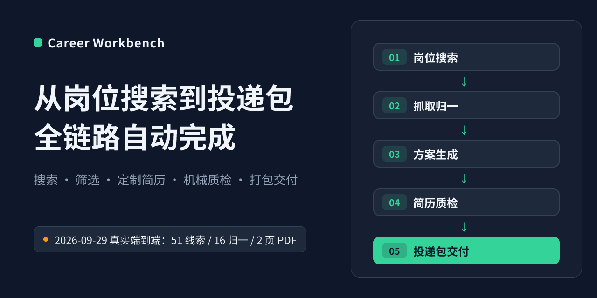
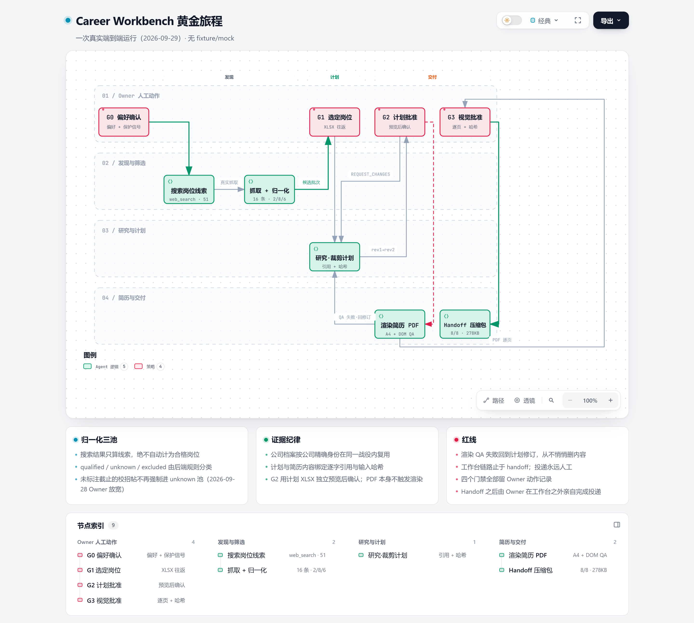
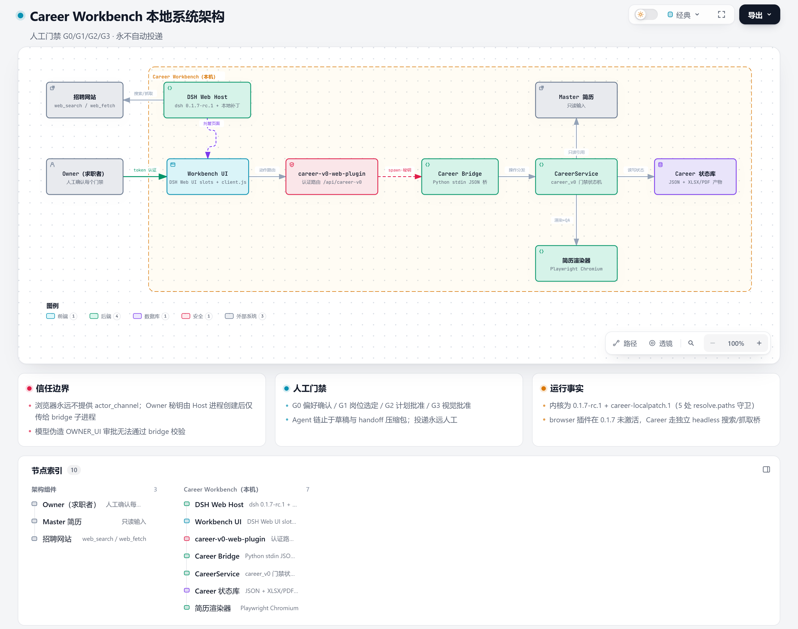

<p align="center">
  
</p>

<h1 align="center">Career Workbench</h1>

<p align="center">本地运行的求职自动化流水线:岗位搜索、抓取归一、方案生成、证据绑定简历、机械 QA、打包交付全链路由 Agent 自动完成,一次真实运行产出 51 条线索、16 个归一岗位和一份 2 页 A4 投递包。当前版本在四个节点保留人工确认(见[能力与边界](#gs-capabilities)),最终投递动作尚未自动化。</p>

## 页内导航

[核心亮点](#gs-highlights) · [工作流](#gs-workflow) · [架构](#gs-architecture) · [技术栈](#gs-techstack) · [安装](#gs-install) · [首次使用](#gs-quickstart) · [能力与边界](#gs-capabilities) · [验证与已知限制](#gs-verification) · [许可证](#gs-license)

<a name="gs-highlights"></a>
## 核心亮点

| 亮点 | 对使用者的价值 |
|---|---|
| 搜索→抓取→归一化→方案→简历→QA→交付,一条流水线跑完求职核心链路 | 你只看结果:真实的候选岗位表、可审阅的投递方案、渲染好的 2 页简历,而不是一堆待办 |
| 真实搜索与抓取,归一化三池(合格/待核实/排除) | 搜索结果只算线索,绝不冒充"合格岗位";每条分类可看风险标记 |
| 计划与简历内容绑定逐字引用与输入哈希 | 简历里的每句话能回溯到 Master 原文或抓取正文,机器批量产出也不编造 |
| 2 页 A4 PDF + 机械 QA(页数/项目齐全/保护文本/行预算) | 渲染失败自动回计划修订,从不悄悄删内容或硬塞第三页 |
| 交接包(完整 JD/研究/PDF/岗位卡) | 打包即交:拿到手的就是可以直接投递的完整材料 |

与常见的一键生成式 AI 求职工具的区别:那些工具把搜索结果当匹配结果、把模型输出直接当简历;本项目的流水线每一步都有确定性校验——搜索结果只归入线索池、简历内容逐句绑定证据、PDF 经机械 QA,校验失败自动回退重做,而不是把半成品交给你。

<a name="gs-workflow"></a>
## 工作流：黄金旅程

下面是一次真实端到端运行(2026-09-29,无 fixture、无 mock):51 条搜索线索 → 16 条归一(合格 2 / 待核实 8 / 排除 6)→ 方案修订一次后批准 → 2 页 A4 PDF(机械 QA 全绿)→ 8 文件交接包(278KB)。搜索、抓取、归一化、方案与简历生成全部在机器侧自动批量完成;QA 失败自动回退到计划修订而不是硬造产物。

<p align="center">
  
</p>

要点:方案被退回过一次(修订环是自动流程的正常路径,不是异常);运行中的人工作用只有四处点击确认(见[能力与边界](#gs-capabilities))。

<p align="center"><a href="./assets/career-golden-journey.html">打开交互式工作流图(本地 HTML,可选增强)</a></p>

<a name="gs-architecture"></a>
## 架构

<p align="center">
  
</p>

分层职责:浏览器永远不持有审批凭证——Owner 秘钥由宿主进程创建,只传给桥接子进程,模型伪造的审批无法通过校验。

```text
                    Owner（求职者）
                        │ token 认证 HTTP·127.0.0.1:18380
                        ▼
┌────────────────────────────────────────────────────────────────┐
│  ┌──────────────┐ 同源 fetch /api/career-v0  ┌──────────────┐  │
│  │ Workbench UI │───────────────────────────▶│ career-v0-   │  │
│  │ (DSH slots)  │                            │ web-plugin   │  │
│  └──────┬───────┘  认证路由 + Owner 秘钥     └──────┬───────┘  │
└────────────────────────────────────────────────────┬───────────┘
                                                      │ spawn 子进程 · stdin/stdout JSON · Owner 秘钥
                                                      ▼
                                                     ┌──────────────────────────────────────┐
                                                     │ CareerService (career_v0, Python)    │
                                                     │ G0-G3 门禁状态机 · 归一化三池        │
                                                     │ 证据绑定简历内容（Master 只读）      │
                                                     └────────────────────┬─────────────────┬───┘
                                                                          │ 读写状态             │ 渲染 + 机械 QA (subprocess)
                                                                          ▼                     ▼
                                                                    ┌──────────────────┐  ┌──────────────────────┐
                                                                    │ Career 状态库    │  │ 简历渲染器           │
                                                                    │ JSON + XLSX 产物 │  │ Playwright Chromium  │
                                                                    │ PDF / 页图产物   │  │ 2 页 A4 + DOM QA     │
                                                                    └──────────────────┘  └──────────────────────┘
```

更细的两级 C4 图与逐条关系证据见[架构文档](./docs/architecture/index.md),交互式架构图在[这里](./assets/career-architecture.html)(均为可选增强,不影响本页理解)。

<a name="gs-techstack"></a>
## 技术栈

| 技术 | 在本项目里的职责 |
|---|---|
| DeepSeek Harness 0.1.7-rc.1(Cordis / TypeScript / Node 22.19+) | Runtime 基座:提供插件架构、Skill 系统、Tool Calling 与 Web 宿主;本项目不改其内核,以版本锁定 + 本地补丁留痕方式装配 |
| Python 3.14 服务层 `career_v0/`(17 个模块) | 领域规则的实现:`domain.py` 门禁状态机与三池分类、`discovery.py` JD 证据接地、`plans.py`/`plan_workbooks.py` 方案与工作簿、`resume_content.py`/`resume_render.py` 简历内容与渲染检视、`store.py` JSON 状态库 |
| React Web Plugin `web_plugin/` | 工作台前端,以宿主插件形式注入 DSH Web,经 `/api/career-v0` 与服务层桥接(`bridge.py` 子进程 + Owner 秘钥) |
| openpyxl | 候选批次与方案审阅工作簿的导出/回读(Excel 里勾选,回传预览) |
| pdfplumber / pypdfium2 | 抓取 JD 的 PDF 解析与简历页图检视 |
| Playwright + Chromium | 2 页 A4 PDF 渲染与 DOM 级机械 QA(页数/项目齐全/保护文本/行预算) |
| unittest(56 用例,11 个模块) | 行为锁定;含 Truth Guard 证据校验、批次分类、方案修订环、渲染往返 |

<a name="gs-install"></a>
## 安装

前置:Windows + Node.js 22.19 或 24+ + Python 3.10+。

1. 安装 Python 依赖(锁定版本与作者验证环境一致):

```text
python -m pip install fpdf2==2.8.7 openpyxl==3.1.5 pdfplumber==0.11.10 pypdfium2==5.12.1
```

2. 安装 DSH 内核(本项目的运行时底座)到任意目录:

```text
npm install @deepseek-ai/dsh@0.1.7-rc.1
```

3. 把 `career_v0/web_plugin` 以 link 方式挂入你的 DSH web profile:`<你的-profile>/package.json` 的 `dependencies` 加 `"career-v0-web-plugin": "link:<本仓库>/career_v0/web_plugin"`,并在同文件 `dsh.profile.bundles` 数组加入 `"career-v0-web-plugin"`(启动脚本会硬校验此项)。

4. 按 `career_v0/start-workbench.ps1` 顶部的常量清单填你自己的路径:`$projectRoot`(本仓库)、`$masterPath`(你的 master 简历)、`$dshPath`(第 2 步安装的 `node_modules/@deepseek-ai/dsh/lib/bin.js`)、`$pythonPath`、`$webProfile`;`career_v0/stop-workbench.ps1` 与 `career_v0/render_resume.mjs` 内的同类路径一并填写(渲染器支持环境变量 `CAREER_PLAYWRIGHT_MODULE` / `CAREER_CHROMIUM_PATH` 覆盖)。

<a name="gs-quickstart"></a>
## 首次使用

先验证安装(56 个测试跑完,已知 1 个分类规则测试未随 2026-09-28 的规则放宽同步,详见[验证与已知限制](#gs-verification)):

```text
python -m unittest discover -s career_v0/tests -t .
```

启动工作台(自动停旧实例 → 启动 DSH Web → 认证 URL 自纠 → 打开浏览器):

```powershell
powershell -NoProfile -ExecutionPolicy Bypass -File career_v0/start-workbench.ps1
```

预期:控制台打印绿色"Career 工作台已就绪"与认证 URL,浏览器打开后左侧栏出现"Career 工作台"。然后:

1. G0 页逐项填写战役偏好、逐个项目给出用途/技术栈/状态,并从 Master 原文逐字复制三个身份信号;先"保存草稿",再点"本人确认 G0"(两者是独立动作)。
2. M1 页"搜索来源线索"→ 逐条"抓取该来源"→"标准化此抓取"→ 勾选后"创建候选批次"→ 导出 XLSX 在 Excel/WPS 里勾选 → 回传预览 → "本人确认 G1 选岗"。
3. M2 页建立岗位研究、拟方案、导出方案 XLSX 审阅回填,确认 G2。
4. M3 页生成候选 PDF,逐页检查后确认 G3,下载交接 ZIP。

用完停止:

```powershell
powershell -NoProfile -ExecutionPolicy Bypass -File career_v0/stop-workbench.ps1
```

提示:若粘贴的 URL 返回 401,取状态目录 `logs/dsh-web-last.out.log` 中最后一条 `dsh web:` 链接重试——DSH 启动早期可能重派生进程导致旧 token 失效,启动器本身已做 HTTP 自纠。

<a name="gs-capabilities"></a>
## 能力与边界

状态词汇:**已实现**(有引用证据)· **已设计**(有设计,未构建)· **不可用**(尝试过,被阻塞)。

**已实现**:G0 战役偏好确认(角色/城市/薪资基准/未知薪资策略/三保护身份信号);真实岗位搜索与抓取、归一化三池(搜索结果只计线索,绝不自动计为合格);候选批次 XLSX 往返(导出→外部编辑→上传预览);裁剪计划生成(含修订环);证据绑定简历内容(HERO/COMPACT 分层);PDF 渲染 + 机械 QA;交接压缩包;Owner 动作认证(浏览器不可伪造审批,匿名访问 API 实测 401);Truth Guard 证据声明校验(确定性文本分析,非 LLM);一键启动/停止(URL 自纠 + 端口直查)。以上均有黄金旅程或测试证据。

**已设计未构建**:多战役导航/历史 UX(现有数据可跨刷新恢复,切换体验待打磨);通知草稿(飞书/邮件 Draft 级,依赖外部凭据)。

**不可用/限制**:公司公开源搜索 provider 在端点余额不足或无联网插件时不可用,JD-first 主流程不受影响;真实公司源链路已在合成测试中验证但尚未经 Web 页面走完。

**本版的自动化缺口(如实)**:流水线上的四个节点仍需人工确认——G0 偏好确认、G1 选岗、G2 方案批准、G3 简历视觉批准;自动投递/自动发送未实现(没有 send/submit 工具)。这四个确认点与最终投递动作是当前版本尚未自动化的部分,流水线的其余环节(搜索、抓取、归一化、方案与简历生成、QA、打包)均为机器自动完成。

<a name="gs-verification"></a>
## 验证与已知限制

- **黄金旅程(2026-09-29)**:G0 本人确认 → 51 条真实线索 → 16 条归一(2/8/6)→ G1 选岗 → 计划 rev1 被退回 → rev2 获 G2 批准 → 2 页 A4 PDF(4 HERO / 7 项目,QA 全绿)→ G3 视觉批准 → 交接包 8/8 文件(278KB)。
- **启动器实测(2026-10-07)**:启动→认证 URL HTTP 303 复验→匿名 API 401→停止 STOP PASS 全链通过;唯一启动警告是 `office-to-pdf` 插件 import 失败,不影响 Career 自带渲染链。
- **测试状态(如实)**:56 个单元/集成测试,2026-09-27 验收运行 56/56 全过;2026-10-07 与 2026-10-10 两次复跑均为 55/56。唯一失败项 `test_unknown_role_experience_jd_and_opening_never_count_as_qualified` 仍按 2026-09-28 规则放宽前的旧预期断言,而产品分类规则已按 Owner 决定放宽(`career_v0/domain.py` 内注释即记录)。属测试预期与放宽后规则未同步;在裁定前,本项目不声称测试全绿。
- **平台限制**:Windows 优先——启动/停止脚本为 PowerShell,渲染链依赖本机 Node 与 Playwright Chromium(`CAREER_NODE_BIN` / `CAREER_PLAYWRIGHT_MODULE` / `CAREER_CHROMIUM_PATH` 环境变量可覆盖);脚本内含需按机器填写的路径常量(见[安装](#gs-install)第 4 步)。
- 完整研发证据(运行时版本实采、manifest 门禁、invocation 日志)保存在项目私有目录,不随本包分发;包内可核对的证据 = 导出源码 + 本节描述的可复现命令。

可选技术参考:[架构文档](./docs/architecture/index.md) · [能力清单](./docs/capabilities.md) · [验证记录](./docs/verification.md) · [插件路由契约](./career_v0/web_plugin/README.md)

<a name="gs-license"></a>
## 许可证

MIT License,见 [LICENSE](./LICENSE)。`career_v0/web_plugin/package.json` 自身亦声明 MIT。
