# 容器图(L2)

可编辑源:[c4-containers.mmd](../../assets/c4-containers.mmd)(Mermaid C4 语法)

## 关系说明

| 起点 | 终点 | 动作/数据 | 协议 | 证据 | 状态 |
|---|---|---|---|---|---|
| Owner | Workbench UI | 使用工作台页面 | HTTPS 到 localhost,token 换 cookie | 启动器实测:303/200,匿名 401 | 已实现 |
| Workbench UI | career-v0-web-plugin | 调用动作路由 | 同源 fetch `/api/career-v0`(JSON;XLSX 上传 ≤10MB) | `career_v0/web_plugin/index.js` 路由表 | 已实现 |
| web-plugin | Career Bridge | 每次操作 spawn 子进程 | stdin/stdout JSON(`python -m career_v0.bridge`) | `web_plugin/index.js:66`;`bridge.py` | 已实现 |
| Career Bridge | CareerService | 操作分发 | 进程内导入 | `bridge.py:run()` | 已实现 |
| CareerService | Career 状态库 | 读写战役状态与产物 | 文件系统(JSON 原子写 + 文件锁) | `career_v0/store.py` | 已实现 |
| CareerService | 简历渲染器 | 渲染候选 PDF + DOM QA | subprocess(Node) | `career_v0/resume_render.py`;`render_resume.mjs` | 已实现 |
| CareerService | Master 简历 | 只读引用 | 文件系统;G0 后 hash 校验 | `service.py:_require_current_master` | 已实现 |
| DSH Web Host | 招聘网站 | headless 搜索与抓取 | DSH web_search / web_fetch | `discovery_runner.py` | 已实现 |

容器边界事实:Workbench UI 与 career-v0-web-plugin 都被 DSH Web Host 进程承载(plugin 经 cordis bundle 挂载);图中"托管页面"关系即此包含关系,不另画进程。
