# 系统上下文(L1)

可编辑源:[c4-context.mmd](../../assets/c4-context.mmd)(Mermaid C4 语法)

## 关系说明

| 起点 | 终点 | 动作/数据 | 协议 | 证据 | 状态 |
|---|---|---|---|---|---|
| Owner(求职者) | Career Workbench | 回答门禁、审阅中间产物、下载 handoff | 浏览器走 localhost HTTP + 一次性 token | `career_v0/start-workbench.ps1`(URL 抓取与 HTTP 验证) | 已实现 |
| Career Workbench | 招聘网站 | headless 搜索线索、抓取岗位页 | DSH web_search / web_fetch(HTTPS) | `career_v0/discovery_runner.py`;黄金旅程 51 条真实线索 | 已实现 |

外部系统保持黑盒:招聘网站与 Master 简历文件的内部结构不属于本系统边界。
